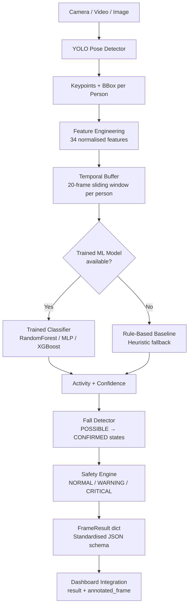

# Onboard HAR — AI Engine + Real-Time Dashboard

> **AI Human Activity Recognition for On-Board BAS Experiments**
>
> Real-time, edge-friendly Human Activity Recognition (HAR) system for
> onboard environments. Includes a full-stack professional dashboard.
> Built for a 1-day hackathon: fast to install, runs on CPU,
> GPU-accelerated automatically when available.

---

## Quick Start

```bash
# 1. Install all dependencies
pip install -r requirements.txt

# 2. Launch the dashboard
cd onboard-har
streamlit run app.py

# 3. Open browser → http://localhost:8501
```

```bash
# AI-only demo (OpenCV overlay, no Streamlit)
python demo_ai.py --source 0          # webcam
python demo_ai.py --source video.mp4  # video file
```

---

## Architecture



---

## Project Structure

```
onboard-har/
│
├── ai/
│   ├── __init__.py       # Package – public interface docs
│   ├── detector.py       # YOLO Pose detection + IoU tracker
│   ├── pose.py           # Pose module re-export shim
│   ├── features.py       # 34-dim feature extraction
│   ├── temporal.py       # Per-person temporal ring buffer
│   ├── classifier.py     # ML + rule-based activity classifier
│   ├── fall_detector.py  # Multi-stage fall detection
│   ├── safety.py         # Safety engine (fuses fall + activity)
│   ├── inference.py      # HAREngine – main entry point
│   └── schemas.py        # Dataclass output contract
│
├── models/
│   └── README.md         # How to train and load models
│
├── data/
│   └── README.md         # Training data format
│
├── tests/
│   ├── test_features.py
│   ├── test_temporal.py
│   ├── test_fall_detector.py
│   └── test_inference.py
│
├── demo_ai.py            # OpenCV debug demo
├── requirements.txt
├── config.yaml           # All tunable parameters
└── README.md
```

---

## Installation

### 1. Create virtual environment (recommended)

```bash
python -m venv venv
# Windows:
venv\Scripts\activate
# macOS/Linux:
source venv/bin/activate
```

### 2. Install dependencies

```bash
pip install -r requirements.txt
```

> For GPU acceleration (optional):
> ```bash
> pip install torch torchvision --index-url https://download.pytorch.org/whl/cu121
> ```

---

## YOLO Pose Model

The YOLO Pose model is **automatically downloaded** by Ultralytics on first
run. No manual download needed.

To pre-download:

```python
from ultralytics import YOLO
YOLO("yolo11n-pose.pt")   # Downloads ~6 MB to ~/.ultralytics/
```

Available model sizes (faster ↔ more accurate):

| Model | Size | Speed |
|-------|------|-------|
| `yolo11n-pose.pt` | ~6 MB  | Fastest (default) |
| `yolo11s-pose.pt` | ~22 MB | Balanced |
| `yolo11m-pose.pt` | ~52 MB | Most accurate |

Change the model in `config.yaml`:

```yaml
model:
  pose_model: "yolo11s-pose.pt"
```

---

## How to Run the Demo

### Webcam

```bash
cd onboard-har
python demo_ai.py --source 0
```

### Video file

```bash
python demo_ai.py --source path/to/video.mp4
```

### Single image

```bash
python demo_ai.py --source path/to/image.jpg
```

### With custom config

```bash
python demo_ai.py --source 0 --config config.yaml
```

### Keyboard Controls (during webcam/video demo)

| Key | Action |
|-----|--------|
| `Q` / `ESC` | Quit |
| `R` | Reset all fall states |
| `S` | Save current annotated frame as PNG |

---

## How the AI Pipeline Works

### 1. Person Detection + Pose Estimation

**Module:** `ai/detector.py`

- YOLO Pose (`yolo11n-pose.pt`) detects people and generates 17 COCO
  keypoints per person.
- A lightweight IoU-based tracker assigns stable `person_id` values
  across frames.

### 2. Feature Engineering

**Module:** `ai/features.py`

Raw pixel keypoints are converted into 34 normalised, body-size-invariant
features including:

- Joint angles (shoulder, hip, knee, elbow)
- Body lean angle (torso tilt from vertical)
- Normalised torso height, body height
- Shoulder and hip widths
- Relative joint positions
- Temporal-ready: designed for statistical aggregation

Missing or low-confidence keypoints default to `0.0` – never crash.

### 3. Temporal Buffer

**Module:** `ai/temporal.py`

- Each person has an independent sliding ring buffer of 20 frames.
- The classifier uses the **sequence** (not just one frame) to detect
  temporal patterns like walking cadence and running rhythm.

### 4. Activity Classification

**Module:** `ai/classifier.py`

Two modes:

| Mode | Label | When used |
|------|-------|-----------|
| Trained ML | `trained_ml` | `models/har_classifier.joblib` present |
| Rule-based | `rule_based_baseline` | No trained model available |

Supported classifiers for training: `RandomForestClassifier`, `MLPClassifier`,
`XGBClassifier`.

### 5. Fall Detection

**Module:** `ai/fall_detector.py`

Three-stage state machine per person:

```
NORMAL → POSSIBLE_FALL → CONFIRMED_FALL
```

Possible fall triggers (any one sufficient):
- Body lean angle > 55° (nearly horizontal)
- Rapid downward hip displacement (> 0.04 normalised/frame)
- Sudden torso height collapse

Confirmation: person remains in fallen posture for 15 consecutive frames.

Recovery: person stands up before confirmation → reset to NORMAL.

### 6. Safety Engine

**Module:** `ai/safety.py`

Combines activity + fall detection into:

| Status | Trigger |
|--------|---------|
| `NORMAL` | No alerts |
| `WARNING` | Possible (unconfirmed) fall |
| `CRITICAL` | Confirmed fall |

---

## Activity Classes

| Activity | Description |
|----------|-------------|
| `STANDING` | Upright, low motion |
| `SITTING` | Low hip, bent knees |
| `WALKING` | Periodic moderate motion |
| `RUNNING` | High-speed, large displacement |
| `FALLING` | Horizontal body + rapid downward motion |
| `UNKNOWN` | Insufficient pose visibility |

---

## Fall Detection Logic

```
Frame N:   Body lean > 55° OR rapid downward movement
                ↓
           State → POSSIBLE_FALL  (WARNING alert)
                ↓
Frames N+1..N+15:  Still in fallen posture?
           YES → State → CONFIRMED_FALL  (CRITICAL alert)
           NO  → State → NORMAL  (recovery)
```

> [!CAUTION]
> Fall detection thresholds require calibration for your specific
> camera angle, mounting height, and environment. See `config.yaml`
> for the relevant parameters.

---

## Output JSON Schema

```json
{
  "timestamp": "2026-09-29T14:30:00.123456",
  "system_status": "NORMAL",
  "people": [
    {
      "person_id": 1,
      "bbox": [100, 120, 300, 500],
      "activity": "WALKING",
      "confidence": 0.94,
      "model_type": "trained_ml",
      "alert": false,
      "alert_type": null,
      "severity": null,
      "evidence": [
        "Continuous body movement detected (motion_std=0.045)",
        "Sequential body position changes observed"
      ],
      "keypoints": [[x, y, conf], ...]
    }
  ],
  "metrics": {
    "people_count": 1,
    "fps": 24.5,
    "latency_ms": 41.2
  }
}
```

Fall example:

```json
{
  "system_status": "CRITICAL",
  "people": [
    {
      "person_id": 1,
      "activity": "FALLING",
      "confidence": 0.92,
      "model_type": "rule_based_baseline",
      "alert": true,
      "alert_type": "FALL_DETECTED",
      "severity": "CRITICAL",
      "evidence": [
        "Significant body angle change (70.2° > 55°)",
        "Rapid downward movement (Δhip_y=0.08)",
        "Person remained in low position after fall"
      ]
    }
  ]
}
```

---

## Dashboard Integration

The dashboard developer only needs:

```python
from ai.inference import HAREngine

engine = HAREngine()   # auto-loads config.yaml

# Per frame:
result, annotated_frame = engine.process_frame(frame)

# result["system_status"]      → "NORMAL" | "WARNING" | "CRITICAL"
# result["people"][0]["activity"]   → "WALKING"
# result["people"][0]["confidence"] → 0.85
# result["people"][0]["alert"]      → False
# result["metrics"]["fps"]          → 24.5
```

---

## How to Train the Classifier

1. Collect labelled feature data (see `data/README.md`).
2. Train:

```python
from ai.classifier import ActivityClassifier
import numpy as np

clf = ActivityClassifier(config={
    "classifier": {
        "model_path": "models/har_classifier.joblib",
        "scaler_path": "models/har_scaler.joblib",
    },
    "activity": {"confidence_threshold": 0.60},
})

clf.train(X_train, y_train, model_type="random_forest")
clf.save()
```

3. Restart the engine – it auto-detects `models/har_classifier.joblib`.

---

## How to Replace the Classifier

The `ActivityClassifier` class accepts any sklearn-compatible model via the
`train()` method. To swap in a custom model:

```python
from sklearn.svm import SVC
clf._model = SVC(probability=True)
clf._model.fit(X_scaled, y_enc)
clf._model_type = "trained_ml"
clf.save()
```

---

---

## Running Tests

```bash
cd onboard-har
python -m pytest tests/ -v
# 78 tests: AI engine (53) + Dashboard (25)
```

Tests run **without GPU or webcam** (YOLO is mocked in inference tests).

---

## Dashboard Architecture

```
app.py                  ← Streamlit entry point (streamlit run app.py)
dashboard/
  __init__.py
  ui.py          ← All HTML/CSS components (aerospace dark theme)
  camera.py      ← Webcam/video source abstraction
  history.py     ← In-memory session recorder + statistics
  analytics.py   ← Plotly chart builders
```

### Dashboard Features

| Panel | Description |
|-------|-------------|
| **System Status Banner** | NORMAL / WARNING / CRITICAL – live from AI |
| **Live Video Feed** | Annotated frame with keypoints, IDs, activity labels |
| **Live Metrics** | Real FPS, latency, people count, session alert count |
| **Person Cards** | Per-person activity, confidence, model type, evidence |
| **Fall Alert** | Prominent animated alert on WARNING/CRITICAL |
| **AI Evidence** | "Why did the AI decide this?" from measured signals |
| **Analytics** | Activity distribution bar chart + timeline scatter |
| **Performance** | FPS/latency over time chart |
| **History Table** | Scrollable per-frame log with most-recent-first |

### Dashboard Controls

| Control | Action |
|---------|--------|
| **▶ START** | Open camera/video and begin processing |
| **■ STOP** | Release camera, halt processing |
| **↺ RESET SESSION** | Clear all history, charts, counters |
| Source type | Webcam (index) or Video File upload |
| Show pose | Toggle keypoint overlay |
| Show evidence | Toggle AI evidence panel |
| Enable alerts | Toggle fall alert banners |

### Alert System

```
AI returns system_status = "WARNING"  → Yellow animated banner
AI returns system_status = "CRITICAL" → Red pulsing alert + evidence
```

---

## Training the Activity Classifier

The onboard-har system features a modular architecture that seamlessly switches between a trained machine-learning classifier and a rule-based fallback.

### Required Dataset
- **Format:** Labeled video clips recorded in the target environment or extracted feature CSVs.
- **Classes:** 5 target activity classes from `ai.schemas.Activity`:
  - `STANDING`
  - `SITTING`
  - `WALKING`
  - `RUNNING`
  - `FALLING`
- **Source Video Diversity:** Minimum of 3 independent source video recordings per class to support leakage-free group-based evaluation (`GroupShuffleSplit`).

### Data Collection
Collect video clips representing diverse subjects and scenarios:
```bash
# Place videos in dataset/raw/<class>/
dataset/raw/
├── standing/standing_01.mp4, standing_02.mp4, ...
├── sitting/sitting_01.mp4, sitting_02.mp4, ...
├── walking/walking_01.mp4, walking_02.mp4, ...
├── running/running_01.mp4, running_02.mp4, ...
└── falling/falling_01.mp4, falling_02.mp4, ...
```

Extract 34-dimensional feature sequences from each recorded video:
```bash
python collect_features.py --input dataset/raw/standing/standing_01.mp4 --label STANDING
python collect_features.py --input dataset/raw/sitting/sitting_01.mp4   --label SITTING
python collect_features.py --input dataset/raw/walking/walking_01.mp4   --label WALKING
python collect_features.py --input dataset/raw/running/running_01.mp4   --label RUNNING
python collect_features.py --input dataset/raw/falling/falling_01.mp4   --label FALLING
```
Extracted features are stored in `dataset/features/*.csv`.

### Dataset Validation
Validate the extracted feature dataset before training to check integrity, class balance, and feature dimensions:
```bash
python dataset_validator.py --data dataset/features
```
The validator verifies:
- 34 numerical features (`f_00` to `f_33`) per sample
- Absence of NaN or Infinite values
- Sample counts and video source diversity per activity class
- Recommendations for class balance and group splitting

### Training
Train the activity classifier using leakage-safe `GroupShuffleSplit`:
```bash
python train_classifier.py \
    --data dataset/features \
    --output models/activity_classifier_v1.joblib \
    --model random_forest \
    --val-frac 0.15 \
    --test-frac 0.15 \
    --seed 42
```
Supported model architectures (`--model`):
- `random_forest` (default, robust baseline)
- `gradient_boost`
- `logistic_regression`
- `svm`

The training pipeline generates:
1. `models/activity_classifier_v1.joblib` (Trained model)
2. `models/activity_classifier_v1_scaler.joblib` (Feature scaler)
3. `models/activity_classifier_v1_meta.json` (Integrity metadata: feature_dim, classes, train_samples, split_strategy, accuracy)

### Evaluation
Evaluation metrics are calculated exclusively on held-out test source videos (never split across train/test):
```bash
# Generated reports in evaluation/
evaluation/
├── metrics.json              # Machine-readable test metrics
├── classification_report.txt # Per-class Precision, Recall, F1, Support
├── confusion_matrix.csv      # Formatted confusion matrix table
└── confusion_matrix.png      # High-resolution confusion matrix plot
```

### Model Loading
Configure the engine in `config.yaml` to point to the trained model:
```yaml
classifier:
  model_path: "models/activity_classifier_v1.joblib"
  scaler_path: "models/activity_classifier_v1_scaler.joblib"
```
On startup, `HAREngine` validates:
1. File existence and joblib serialization integrity.
2. Metadata feature dimension matching `FEATURE_DIM = 34`.
3. Existence of `predict_proba()` method.
4. Feature scaler input dimension compatibility.

If all integrity checks pass, the classifier mode switches to `TRAINED ML`.

### Rule-Based Fallback
If no trained model is present, or if any integrity check fails (e.g. corrupt model, feature dimension mismatch):
- The engine safely falls back to `rule_based_baseline`.
- The reason is recorded in `load_error` and displayed in the AI Diagnostics panel.
- The system operates without crashing or interrupting monitoring.

### Reproducing Results
Run pipeline tests and verify end-to-end training and inference:
```bash
# Test classifier integrity, loading, and rejection
python -m unittest tests/test_classifier_integrity.py

# Test dataset collection, validation, and training components
python -m unittest tests/test_dataset.py

# Run full project test suite
python -m pytest tests/ -v
```

---

## Limitations

1. **No trained model** – system ships with rule-based fallback only.
   Training data must be collected for your specific use case.

2. **Fall thresholds need calibration** – the default values work for
   typical camera angles but should be tuned for your mounting position.

3. **Single-camera, fixed scene** – not designed for multiple camera fusion.

4. **Occlusion handling is basic** – heavy occlusion leads to `UNKNOWN`
   activity classification.

5. **IoU tracker** – simple tracker can swap IDs if two people cross paths
   very close together. A stronger tracker (ByteTrack, BotSORT) can be
   plugged in by modifying `detector.py`.

6. **Activity confidence with rule-based baseline** – confidence values
   are heuristic scores, NOT calibrated probabilities.

---

## Future Improvements

- [ ] Automated training data collection script
- [ ] ByteTrack / BotSORT integration for better multi-person tracking
- [ ] LSTM / Transformer temporal classifier (if more training data available)
- [ ] Multi-camera fusion
- [ ] Confidence calibration for rule-based mode
- [ ] Alert logging to file / database
- [ ] Posture quality assessment (ergonomics)
- [ ] Crowd density estimation

---

## Dependencies

| Library | Purpose |
|---------|---------|
| `ultralytics` | YOLO Pose model |
| `opencv-python` | Frame capture and visualisation |
| `numpy` | Numerical operations |
| `scikit-learn` | ML classifier + scaler |
| `joblib` | Model serialisation |
| `PyYAML` | Configuration loading |
| `pandas` | Data handling + history table |
| `streamlit` | Real-time dashboard framework |
| `plotly` | Interactive analytics charts |
